# Architecture Through Ten Perspectives

Status: **mechanism walkthrough** (2026-11-23). Explains how the maintained
runtime is shaped across ten common Agent evaluation angles. This is not an
acceptance ledger, pilot scorecard, or interview script. For capability evidence
and limits see [Project Overview](project-overview.md). For process entrypoints
and modular boundaries see [Engineering Architecture](architecture.md). For
pattern taxonomy (including patterns we do *not* ship) see
[Agent Architectures](agent-architectures.md).

Agent Kernel is a self-hosted **durable Run runtime / workbench**, not a
LangGraph application and not a chat-first Copilot. LLM tool-calling, RAG, and
memory sit on top of a custom state machine, worker lease, policy gate, and
human approval/resume path.

## Big picture

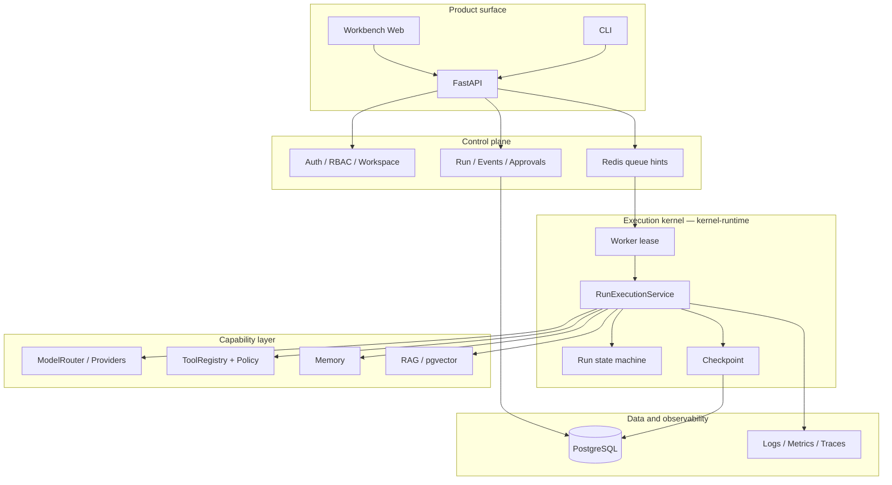

In one line: **API / Web / CLI own tasks and permissions; Worker + runtime own
durable execution; LLM / tools / memory / knowledge are pluggable capabilities;
PostgreSQL is the source of truth; observability follows the Run.**

---

## 1. Perception and decision

Runs do not “chat the model from the browser.” When a Run becomes `running`,
`RunExecutionService` calls `ModelRouter` (`mock` / `openai` / `deepseek`, …).

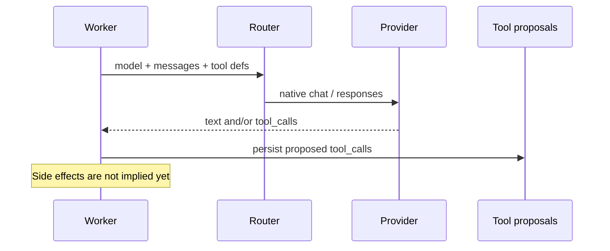

- **Inputs:** task text, optional system prompt, optional memory envelope, tool
  schemas.
- **Decision:** provider-native tool-calling (`tool_choice: auto`), or an
  explicit `input.tool` path (used heavily by the showcase).
- **Outputs:** answer text and/or proposed tool calls. **Proposal ≠ execution.**

Primary code: `packages/kernel-runtime` (`execution.py`, `router.py`),
`packages/kernel-providers`.

---

## 2. Tools and action

Tools go through a shared registry, risk metadata, and policy before any side
effect.

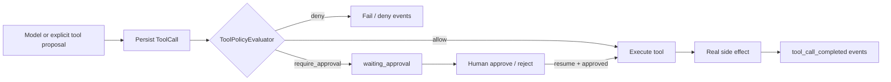

- **Sources:** built-ins, `kb_search`, MCP / OpenAPI external bindings.
- **Risk levels:** `read_only` | `external_write` | `filesystem_write` |
  `network` | `dangerous`.
- **Pins:** external bindings may require `response_sha256`; mismatch fails
  closed (used on the supervised GitHub path).

Primary code: `packages/kernel-tools`, `packages/kernel-policy`,
`packages/kernel-rag` (`kb_search`). Spec: [tool-calling](specs/tool-calling.md).

---

## 3. Memory and knowledge

Two channels, different trust models.

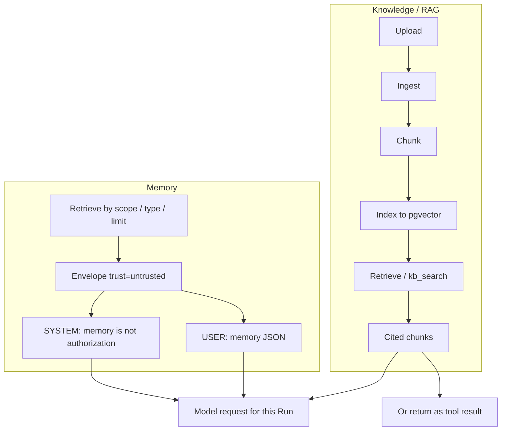

- **Memory** may influence wording; it must not grant tool rights (CF1 /
  [memory-context-safety](specs/memory-context-safety.md)).
- **RAG** is an auditable document pipeline with citations; Workbench exposes
  Prepare-for-retrieval plus stepped indexing.

Primary code: `packages/kernel-memory`, `packages/kernel-rag`.

---

## 4. Orchestration and runtime

Custom durable single-agent executor: state machine + queue worker + lease +
checkpoint. **No LangGraph / LangChain orchestration dependency.**

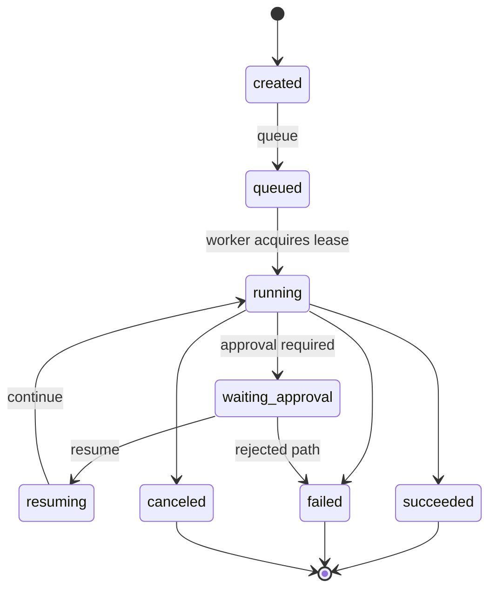

| Piece | Role |
| --- | --- |
| Redis | Queue hints (what to pick up) |
| PostgreSQL | Source of truth for runs, events, approvals, checkpoints |
| Worker lease + heartbeat | Avoid double execution; expired leases can be reclaimed |
| `execution_checkpoint` | Persist native cursor across approval pauses |

Note: some approval-resume paths can still execute inside an API request; do not
claim every continuation is async Worker-only. See [architecture.md](architecture.md).

Primary code: `packages/kernel-runtime`, `apps/worker`, `packages/kernel-storage`.

---

## 5. Human-in-the-loop (HITL)

Approval is a first-class persisted state. **Approve does not execute the tool.**

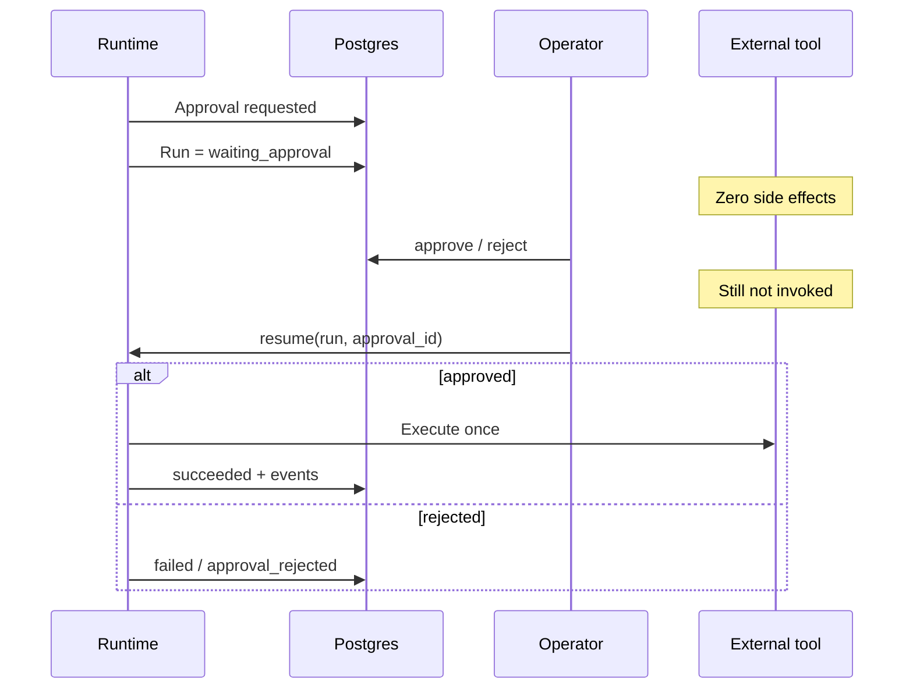

Workbench maps this to Queue → Approvals → Resume run. Showcase rehearsal:
[mock-happy-path](showcase/mock-happy-path.md).

---

## 6. Security and governance

Cross-cutting controls, not a separate “security microservice.”

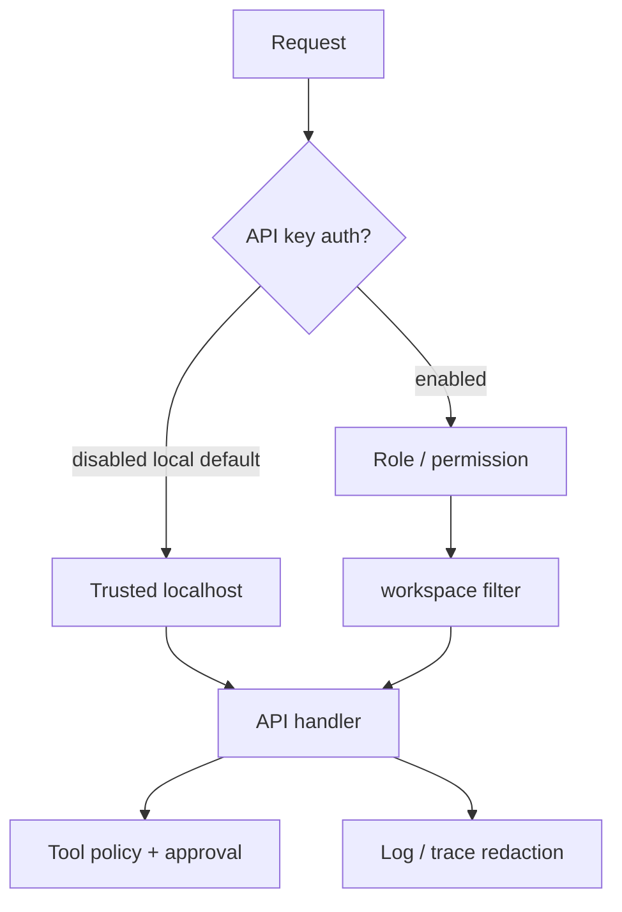

- Agents, runs, KBs, memory, and approvals are workspace-scoped when auth is on.
- Tool execution context is built from the persisted Run/workspace, not from
  model-supplied identity.
- Default Docker profile is a **trusted single-user localhost** posture; that is
  not public multi-tenant SaaS. See [Auth and RBAC](auth-rbac.md),
  [SECURITY](../SECURITY.md).

---

## 7. Evaluation and quality

Engineering regression and pilot quality gates are separate signals.

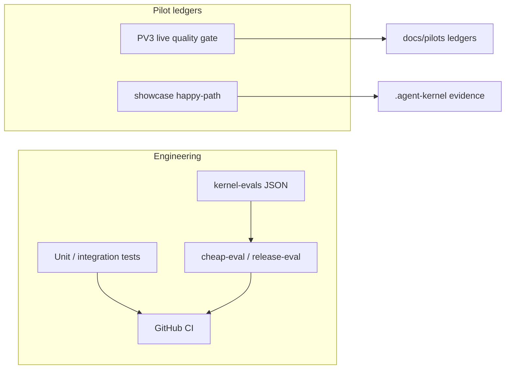

Maintainer walkthroughs and CI passes do not replace independent-user PV5. See
[quality-strategy](quality-strategy.md), [real-scenario pilot plan](real-scenario-pilot-plan.md).

---

## 8. Observability and operations

Apps emit logs/metrics/traces into the local Compose observability stack.
Workbench only deep-links **this Run’s** clues; fleet panels stay in Grafana.

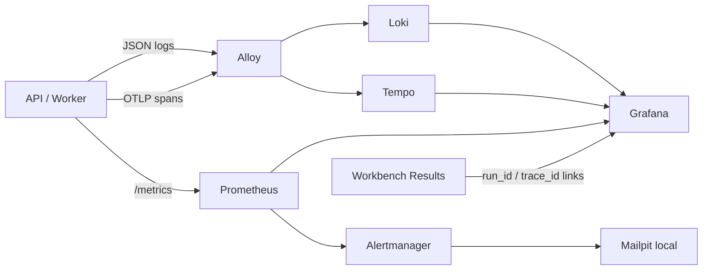

- Workbench Results: `trace_id`, token totals, links to Loki Explore, Tempo
  Explore, and the Operations dashboard (`apps/web/src/lib/observability-links.ts`).
- Ops drills (restart / backup / upgrade / soak) are recorded under the PV4
  ledger, not inside the Web app.

See [docker-local](docker-local.md), [observability-backends](observability-backends.md),
[observability-operations](observability-operations.md).

---

## 9. Product and experience

The Workbench is a **task console**, not a chat transcript UI.

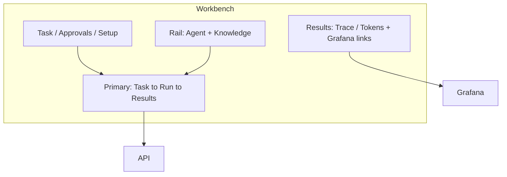

- Primary path: choose Agent → write Task → Create / Queue → approvals / answer.
- Knowledge pipeline is secondary (Prepare + optional indexing steps).
- CLI and REST expose the same control plane; Web is one operator surface.
- Streaming chat-first journey is out of current scope (CF4 deferred).

See [user-experience](user-experience.md), [product-shape](product-shape.md).

---

## 10. Engineering foundations

Modular monolith in one repo; Docker-only default local runtime; PostgreSQL only.

```text
apps/
  api      HTTP control plane
  worker   execution loop
  cli      operator / script entry
  web      Workbench
packages/
  kernel-runtime         state machine / execution / queue
  kernel-providers       model adapters
  kernel-tools           tools / MCP / OpenAPI
  kernel-policy          tool policy
  kernel-rag             knowledge base
  kernel-memory          memory
  kernel-storage         PostgreSQL repositories
  kernel-identity        identity
  kernel-observability   logs / metrics / traces
  kernel-evals           evaluation
  kernel-core            shared models
```

- Local: `make docker-up` (mock) or `make docker-paid-up` (paid overlay).
- Tests must use disposable PostgreSQL, never the live Docker runtime DB.
- Secrets stay in ignored `.agent-kernel/docker-local/`, never in `NEXT_PUBLIC_*`.

See [modules](modules.md), [postgresql-only](postgresql-only.md),
[docker-local](docker-local.md), ADR 0001–0004 under [adr/](adr/).

---

## End-to-end path across the ten layers

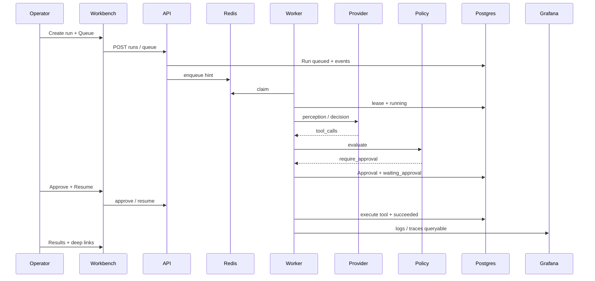

## Ten-perspective map

| Perspective | Where it lives in this system |
| --- | --- |
| 1 Perception & decision | Providers + native tool-calling |
| 2 Tools & action | Registry + policy + executor |
| 3 Memory & knowledge | Untrusted memory envelope + RAG pipeline |
| 4 Orchestration & runtime | State machine + worker lease + checkpoint |
| 5 HITL | Approval entity + explicit resume |
| 6 Security & governance | Auth/RBAC/workspace + redaction |
| 7 Evaluation & quality | evals + CI + pilot ledgers |
| 8 Observability & ops | OTEL / Loki / Tempo / Prometheus + PV4 drills |
| 9 Product & experience | Task-first Workbench |
| 10 Engineering foundations | Modular packages + Docker / PostgreSQL contracts |

## Explicit non-goals (for this document)

- Not a claim that every pattern in [agent-architectures.md](agent-architectures.md)
  is implemented (no durable multi-agent DAG/swarm as a product feature).
- Not PV5/PV6 closure or CF3–CF8 delivery status.
- Not a billing system: token fields may exist; `estimated_cost` is not an
  authoritative invoice.
- External tool side effects are not claimed exactly-once.
